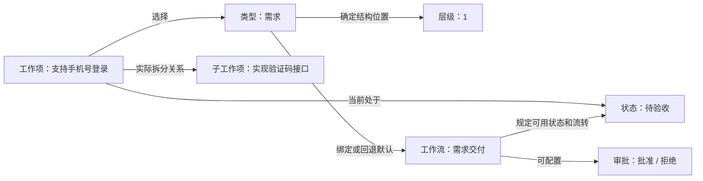
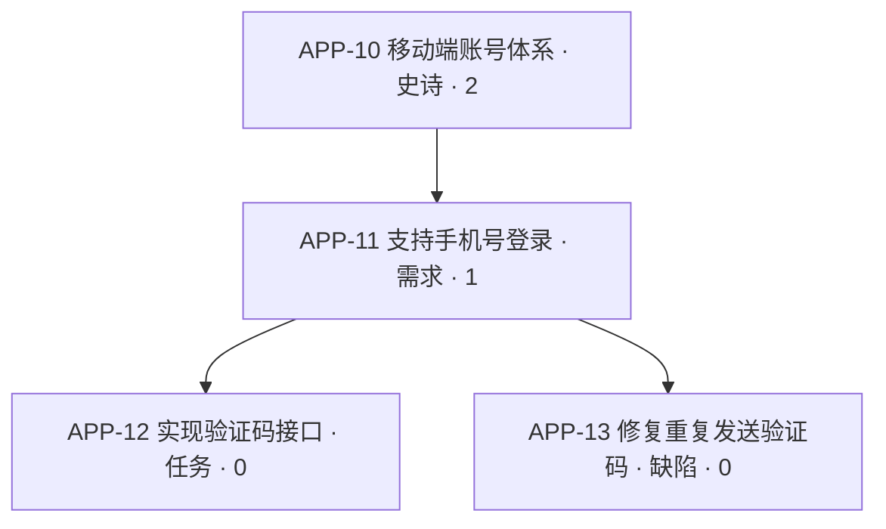

# 项目工作项、类型、工作流与层级使用指南

当一个项目既有大目标，又有需求和具体任务时，需要同时回答两个问题：**这件事属于哪件更大的事？这件事现在走到哪一步、接下来谁能操作？**

层级与父子关系回答前一个问题，状态与工作流回答后一个问题。类型把两者连接起来：它既决定工作项处于哪个层级，也决定工作项使用哪个工作流。把这些规则配置好，可以避免任务拆分随意、不同业务混用流程，以及待审批事项被直接拖到完成等问题。

本文面向项目管理员和日常使用者，说明当前产品能力。以下配置均以**单个项目**为范围；不同项目可以采用不同的类型、层级和工作流。技术接口、脚本和部署细节见[项目工作流、审批与 Runner](./project-workflows.md)。

## 先分清五个概念

| 概念   | 回答的问题                                     | 例子                                           |
| ------ | ---------------------------------------------- | ---------------------------------------------- |
| 工作项 | 具体要做哪件事？                               | 「支持手机号登录」，有自己的编号、负责人和进度 |
| 类型   | 这是一类什么工作？                             | 史诗、需求、任务、缺陷；名称由项目自行定义     |
| 状态   | 这件事目前处于什么阶段？                       | 待开始、开发中、待验收、已完成                 |
| 工作流 | 这一类工作有哪些可用状态，如何流转、由谁操作？ | 需求必须先评审，验收批准后才能完成             |
| 层级   | 这一类工作在拆分结构中处于哪一层？             | 史诗为 2，需求为 1，任务与缺陷为 0             |

类型是分类，工作项是具体实例。同一类型可以有很多工作项；多个类型可以共享一个工作流。同一层可以放多个类型，也可以让它们分别使用不同工作流。层级数字不是优先级，也不是当前完成程度。

图中的「需求」「需求交付」都是示例名称。给类型起名为「史诗」不会自动获得层级 2；实际规则以项目为该类型配置的数字层级为准。

## 层级怎样约束实际的父子关系

层级配置是一张「哪些类型可以成为上下层」的规则表；工作项上的父项关联才是真正的拆分关系。配置类型不会自动创建工作项，也不会自动把已有工作项连接起来。

启用层级后，父项的层级必须恰好比子项高 1，即 **父层级 = 子层级 + 1**。例如 2 → 1、1 → 0 合法，2 → 0 跳层、1 → 1 同层和 0 → 1 反向关联均不合法。每个工作项最多有一个直接父项，可以有多个直接子项。

具体含义如下：

- 层级 0 是最底层，不能再挂子工作项。无类型工作项也按 0 层处理。
- 任意层级都可以有独立工作项。1 层需求不必先挂到 2 层史诗上，0 层缺陷也可以单独存在。
- 父子工作项必须属于同一个项目，不能将自己或自己的后代设置为父项。
- 层级由类型决定，不能在某一个工作项上单独修改数字。更换类型可能改变该工作项的层级。

### 尚未启用时

项目未启用层级时，仍可建立父子嵌套，类型的数字层级不限制父子搭配；例如同为 0 层的任务也可以互为上下级。但不能跨项目关联、不能形成循环。类型与工作流仍可正常使用，启用工作流不等于启用层级。

**层级一旦在项目中启用，当前产品不支持再关闭。** 在首次启用前，先检查已有拆分方式，并查看保存时的影响预览。启用后仍可调整类型的层级，但必须遵循配置预览和冲突处理流程。

### 无类型不等于没有规则

无类型工作项在结构上属于 0 层，在流程上回退到项目默认工作流。因此，启用层级后它可以挂到 1 层工作项下面，不能直接挂到 2 层下面，也不能充当其他工作项的父项。如果默认工作流生效，其中的路径和审批规则仍适用于无类型工作项。

## 工作流怎样决定状态和审批

每个类型可以绑定一个项目工作流。未显式绑定的类型，以及无类型工作项，使用项目默认工作流。多个类型可以共用同一个工作流；同层的「任务」和「缺陷」也可以分别使用开发流程与缺陷修复流程。

状态本身属于项目，并归入待办、未开始、进行中、已完成、已取消这五种普通状态组。工作流在这些状态上增加规则：默认工作流涵盖项目所有普通状态，自定义工作流可以选用其中一部分；需求收集的 triage 状态另行处理。

当项目工作流总开关开启，且选中的工作流处于启用状态时，工作项会遵循以下规则：

- 创建时优先进入工作流配置的初始状态；未设置时使用项目默认状态，再按普通状态顺序回退。可以禁止在某些状态直接创建，初始状态始终可创建。
- 某个来源状态没有配置出站规则时，可以在该工作流允许的状态内自由切换。
- 来源状态配置了普通流转规则后，只能前往配置的目标；还可以限定哪些有基础写权限的成员能执行。管理员同样需要遵守这些限制。
- 流转可以附加前置校验和后置动作。前置未通过时不能流转；后置在流转成功后执行，失败不会自动撤回已经发生的状态变化。

关闭项目工作流总开关，或暂停某个工作流，会保留配置并暂停对应流程约束；明确绑定到已暂停工作流的类型不会转而执行默认工作流。**这不会关闭已经启用的层级规则。**

### 审批是工作流中的一种流转方式

「待验收」这个状态名称本身不代表必须审批。只有将该状态的出站规则配置为审批，工作项进入它时才会建立待审批记录。审批分支包含批准目标、拒绝目标和可审批成员；同一来源状态的出站规则需统一为普通流转或审批，不能混用。

例如，需求进入「待验收」后，产品负责人可以批准到「已完成」，或者拒绝回「开发中」。当前采用**任意一位有资格的审批人作出一次有效决定即可生效**的方式，不是所有审批人都必须同意的全员会签。审批记录保存进入当时的分支和人员快照，后来加入项目的人不会自动获得旧审批的资格；操作时还会重新检查当前权限。

审批状态不能通过普通状态编辑、看板拖拽、修改类型或脚本写入绕过。批准或拒绝到达另一个审批状态时，可以建立下一轮审批。

父子关系不会让审批自动传递：批准需求不会自动批准或完成它的任务，所有任务完成也不等于需求自动通过验收。各工作项仍按自己的类型、工作流和当前状态处理。若要增加「所有子项完成后才允许验收」之类的业务条件，需要另外设计并验证相应规则，层级本身不提供这个条件。

## 一个完整的 2 → 1 → 0 示例

假设项目要交付「移动端账号体系」，管理员配置如下。名称和流程均为示例，需要在项目中自行创建。

| 类型 | 层级 | 工作流及用途                                                       |
| ---- | ---- | ------------------------------------------------------------------ |
| 史诗 | 2    | 交付规划：管理较大的业务目标                                       |
| 需求 | 1    | 需求交付：待开始 → 开发中 → 待验收，验收批准到已完成，拒绝回开发中 |
| 任务 | 0    | 开发执行：待开始 → 进行中 → 已完成                                 |
| 缺陷 | 0    | 缺陷修复：待确认 → 修复中 → 待验证 → 已关闭                        |

实际工作项可以这样组织：

团队先创建史诗，再在它下面建立需求，在需求下面拆任务、登记缺陷。任务与缺陷同为 0 层，可以成为同一需求的子项；它们仍然各走各的工作流。不能把 APP-12 直接挂到 APP-10 下，也不能给 APP-12 再加一个 0 层子任务。如果还要进一步拆分，需要重新评估类型层级设计。

开发人员将 APP-12 推进到已完成、将 APP-13 推进到已关闭。确认交付内容后，再把 APP-11 送入待验收，由指定审批人决定。APP-10 的状态也独立维护；不会仅因 APP-11 完成就自动完成。

如果把 APP-12 从「任务」改为同层「缺陷」，结构上允许，但还要检查它当前状态是否属于缺陷修复工作流，以及原工作流是否允许相应操作。若试图把 APP-11 从 1 层「需求」改为 0 层「任务」，它与 2 层父项的关系会跳层，而且现有 0 层子项也会与它同层，这次普通修改会被拒绝。

## 默认类型和默认层级分别影响什么

| 设置           | 何时生效                                                 | 不会产生的效果                                       |
| -------------- | -------------------------------------------------------- | ---------------------------------------------------- |
| 项目默认类型   | 创建工作项且未指定类型时，采用有效的项目默认类型         | 不会改写已有工作项，也不会保证该类型适合所选父项     |
| 项目默认层级   | 新建类型时，作为未另选层级的初始值                       | 不会把所有新工作项直接设到这一层，也不会替换默认类型 |
| 项目默认工作流 | 类型没有专门绑定工作流，或工作项没有类型时，作为流程回退 | 不决定工作项层级，也不会创建父子关系                 |

例如，默认类型是 0 层「任务」、默认层级是 1：普通新建工作项仍默认使用「任务」；新建一个名为「用户故事」的类型时，其初始层级为 1。默认层级与默认类型所在层不必一致。

创建时明确选择无类型，与没有指定类型的默认行为也不同：前者按无类型、0 层处理，后者可以自动采用项目默认类型。编辑已有工作项时，没有修改类型就保留原值。

从父项下创建子项时，应选择恰好低一层的有效类型。若默认类型不符合父项要求，需要另选合适类型；系统不会通过跳层来迁就默认值。

## 普通编辑与管理员配置变更的区别

### 修改某个工作项

日常编辑工作项时，系统检查修改后的类型与父项组合。更换类型还会检查已有子项，包括归档项和草稿子项；不能只让它与父项合法，却破坏它与子项的关系。

遇到冲突时，本次修改会被拒绝，不会自动拆散父子关系。可以先解除或调整相关关联，再选择符合规则的类型。若某个入口支持同时提交类型和父项，系统按两者合并后的最终结果校验。

层级合法也不表示工作流一定允许：换类型后的当前状态必须属于目标工作流。若不属于，需要明确选择合法目标状态；这次状态变化仍受原工作流的路径、操作成员和审批限制，不能借换类型绕过待审批状态。

### 调整项目的类型层级

管理员在项目设置的「工作项」→「层级」中，可以添加层级、移动类型、设置默认层级，再保存并查看预览。启用层级后，已有类型的层级须在这里集中调整，类型编辑窗口不直接修改它。

保存前会展示最终层级、默认层级、冲突数量及部分父子关联样例。检查范围包含项目工作项、归档工作项和独立草稿。有冲突时，确认应用的结果是：**解除冲突子项的父项关联，保留工作项本身**。系统不会替它们另找父项，不会删除子项，也不会自动重建一棵新树。合法关联继续保留。

例如把「需求」从 1 层移到 0 层，所有使用该类型的工作项都将按新的层级解释。原有 2 → 1 和 1 → 0 关联可能同时失效，需要在预览中检查并决定是否接受解除。解除后可重新整理关联，但没有一键恢复旧结构的能力。

预览不是永久有效的承诺。预览后若配置或工作项发生变化，或者预览过期，应用可能被拒绝，需要刷新预览并重新核对。

层级从 0 起连续编号，保存时会压紧不连续数字，默认层级同步调整。界面中新增的层级需先放入类型才能保存；删除层级前要先移走其中的类型，0 层不能删除。不要把数字当成长期固定的业务编号。

### 修改工作流绑定或移除类型

这类变更使用工作流的影响预览：例如给「需求」改绑流程，如果现有工作项处于新流程不包含的状态，管理员必须提供状态映射；相关旧审批可能失效，并按目标情况建立新审批。管理迁移不会执行普通流转边上的前置、后置脚本。

这与层级预览的「解除父项关联」是两种处理。移除类型会使相关工作项变为无类型、按 0 层和默认工作流处理，仍须通过层级校验；工作流迁移不会自动替你修复由此产生的父子冲突。默认类型受保护，移除前应先指定另一个默认类型。

## 建议的配置与使用步骤

1. **先确定拆分方式。** 列出项目的大目标、中间需求和最小执行单元。只有两层需求时可以用 1 → 0，不必强行套用三层。
2. **创建类型。** 在项目设置「工作项」的类型列表中创建类型，选择名称、图标和层级；设置日常创建最常用的默认类型。按需在属性设置中配置业务信息，属性不代替层级或流转规则。
3. **配置流程。** 在项目「工作流」设置中准备状态集合、初始状态、普通流转和审批分支，再给类型绑定流程。需要执行约束时开启项目工作流总开关，并确保相应工作流启用。
4. **整理并启用层级。** 进入「层级」页分配类型、设置新类型的默认层级，检查已有父子关系。首次启用不可撤销，保存时逐项核对预览；有冲突时决定先手动整理，还是确认解除冲突关联。
5. **按实际工作拆分。** 先创建上层工作项，再创建或关联相邻下一层的子项；为各项分别设置负责人和状态。相同层级可以使用不同类型，不必共用流程。
6. **按流程交付。** 通过普通状态操作推进执行，通过审批入口作出批准或拒绝；分别检查各层的结果。后续更换类型、移动父项或调整配置时，再核对结构与流程两方面的影响。

## 当前能力边界

- 层级、类型绑定、默认设置、状态和工作流均按项目配置；不提供工作区统一层级治理，也不支持跨项目父子树。
- 层级是类型的数字顺序，支持多个类型同层及继续增加更高层；当前不提供按每一对类型单独配置的父子白名单，也不允许启用后的同层嵌套或跨层挂载。
- 配置层级不会自动生成任务、继承负责人、同步日期、汇总完成状态或触发父项审批。需要额外业务动作时，应单独设计相应自动化或脚本，不能把父子关联视为已实现这些能力。
- 草稿可以暂不执行正式工作流流转，但保存时仍检查结构；发布时会重新校验正式规则。草稿不是绕过层级的入口，归档也不会让真实父子关联退出层级检查。
- 审批支持分支和逐次决定，不提供全员会签。脚本有明确的能力与字段范围，当前 SDK 不开放父项关联写入；不能假设脚本可任意重排整棵树。
- 层级配置冲突处理提供预览和确认解除关联，不提供自动类型转换、自动补中间工作项或撤销整次结构迁移。建议在影响较大的调整前先确定新的拆分方案。

## 规则核对位置

本文按当前仓库实现编写，后续调整产品规则时可对照以下位置更新：

- [层级服务](../apps/api/plane/services/hierarchy.py)：相邻层级、父子双向校验、配置预览与解除关联。
- [工作流写入规则](../apps/api/plane/utils/workflow.py)：默认类型、有效工作流、状态和审批保护。
- [工作流管理迁移](../apps/api/plane/services/workflow.py)与[审批服务](../apps/api/plane/services/workflow_approval.py)：状态映射、审批实例与决定。
- [项目设置接口](../apps/api/plane/app/views/project/workflow.py)与[层级设置界面](../apps/web/components/workflow/types-hierarchy.tsx)：默认层级、集中调整及保存流程。
- [层级契约测试](../apps/api/plane/tests/contract/app/test_project_hierarchy.py)与[草稿和 SDK 层级测试](../apps/api/plane/tests/contract/app/test_hierarchy_drafts_sdk.py)：未启用行为、2 → 1 → 0、冲突处理和写入边界。
